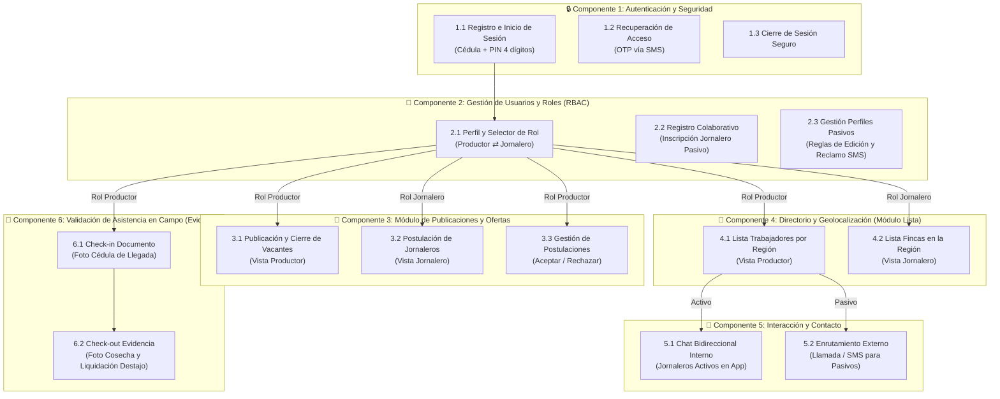

# 🌾 AgroConecta - Arquitectura DFD y Mockups de Alta Fidelidad

Prototipos interactivos y mapa de arquitectura para la plataforma **AgroConecta**, diseñada para conectar **Productores (Mayordomos)** y **Jornaleros** en zonas rurales de Colombia para trabajo al destajo (recolección de café, guadaña, fumigación, carga y labores agrícolas).

---

## 📌 Modelo de Control de Acceso Basado en Roles (RBAC)

> [!NOTE]
> **Arquitectura de Identidad Única**: Existe un **único tipo de usuario general en la base de datos**. La interfaz gráfica de la aplicación (frontend) se adapta dinámicamente, ocultando o mostrando funcionalidades según el rol seleccionado por el usuario en ese momento (**Productor** o **Jornalero**).

---

## 🎯 Principio Rector: "Baja Fricción Tecnológica"

El diseño de AgroConecta responde a las realidades de conectividad y usabilidad del campo colombiano:
- **Cero correos electrónicos y cero contraseñas complejas**: Identificación ágil y unificada mediante **Cédula de Ciudadanía** y **PIN numérico de 4 dígitos**.
- **Jerarquía visual limpia**: Tipografía de gran tamaño (mínimo 16px - 22px en entradas numéricas), contrastes altos y botones de llamado a la acción (CTA) evidentes y protagónicos.
- **Tolerancia a fallos y errores guiados**: Si un trabajador o productor se equivoca, la UI no castiga ni reinicia el proceso; mantiene intacto el estado válido.
- **Inclusión de Trabajadores Pasivos (Sin Smartphone)**: Permite inscribir a jornaleros sin teléfono inteligente y provee enrutamiento nativo a llamadas telefónicas y SMS estándar.

---

## 🏗️ Fase de Descomposición Oficial (6 Componentes DFD)



---

### Componente 1: Autenticación y Seguridad
Puerta de entrada al sistema diseñada para eliminar las fricciones tecnológicas y permitir que la población rural acceda sin correos ni contraseñas complejas.
* **Subcomponente 1.1: Registro e Inicio de Sesión**:
  * Autenticación de acceso rápido usando la **Cédula** y un **PIN numérico de 4 dígitos**.
  * Onboarding unificado (sin botones separados de "Iniciar Sesión" y "Registrarse").
  * Si la cédula existe $\rightarrow$ solicita el PIN existente con atajo a recuperación.
  * Si la cédula no existe $\rightarrow$ inicia el micro-flujo de creación de PIN (Paso 1: Ingresar PIN; Paso 2: Confirmar PIN).
  * **Regla estricta de persistencia ante errores**:
    * *Error de formato*: *"El PIN debe tener 4 números exactos"* (devuelve y enfoca el primer campo).
    * *Error de coincidencia*: *"Los PIN no coinciden"*. La UI solo limpia y solicita de nuevo el campo de confirmación, manteniendo intacto en memoria y pantalla el primer PIN ingresado.
* **Subcomponente 1.2: Recuperación de Acceso (OTP)**:
  * Restablecimiento seguro del PIN olvidado mediante el envío de un código temporal (OTP de 4 números) por mensaje de texto (SMS) al celular registrado.
* **Subcomponente 1.3: Cierre de Sesión**:
  * Funcionalidad básica de seguridad para salir de la cuenta de forma segura en el dispositivo móvil y evitar accesos no autorizados en teléfonos compartidos.

---

### Componente 2: Gestión de Usuarios y Roles
Administración de la información, los estados y las relaciones de los usuarios dentro de la red, permitiendo el crecimiento de la plataforma y el cambio dinámico de interfaz bajo el modelo RBAC.
* **Subcomponente 2.1: Selector Dinámico de Rol (Menú Principal Post-Login)**:
  * Pantalla inicial que el usuario ve inmediatamente tras validar su PIN numérico.
  * Diseñada con cero fricción: mensaje de bienvenida ("¡Hola, Hernán!") y **únicamente dos tarjetas grandes**:
    1. **Modo Productor (Buscar trabajadores)**: Publicar vacantes al destajo, gestionar candidatos y validar asistencia.
    2. **Modo Jornalero (Buscar trabajo)**: Ver fincas cercanas en la vereda, postularse y recibir aviso para ir a la finca.
* **Subcomponente 2.1: Perfil del Usuario (Pantalla Secundaria Aparte)**:
  * Pantalla independiente accesible desde el encabezado únicamente para consultar y editar datos de contacto: Cédula (llave inmutable de seguridad), nombre completo, celular y vereda de residencia.
* **Subcomponente 2.2: Registro Colaborativo de Terceros**:
  * Módulo donde cualquier usuario activo puede inscribir al directorio a un trabajador sin smartphone (**Jornalero Pasivo**), digitando únicamente la cédula, el teléfono básico y la vereda de esa persona.
* **Subcomponente 2.3: Gestión de Perfiles Pasivos (Reglas de Edición)**:
  * Lógica de permisos donde la Cédula es llave única inmutable.
  * El creador original tiene propiedad inicial de edición para actualizar datos de contacto.
  * El trabajador pasivo puede reclamar su perfil vía SMS OTP para tomar control total y volverse **Jornalero Activo** al adquirir un smartphone.
  * Mecanismo para sugerencias de corrección comunitaria.

---

### Componente 3: Módulo de Publicaciones y Ofertas
Motor transaccional que conecta directamente la oferta de trabajo con la necesidad de empleo, eliminando los desplazamientos presenciales de madrugada a la plaza y la incertidumbre diaria.
* **Subcomponente 3.1: Publicación y Cierre de Vacantes (Vista Productor)**:
  * Interfaz donde el productor detalla su necesidad para el día (labor agrícola, cantidad de personas requeridas y tarifa al destajo).
  * Funcionalidad destacada para modificar su estado a **"Completada / Cerrada"** para retirarla de la vista pública una vez cubiertos los cupos.
* **Subcomponente 3.2: Postulación de Jornaleros (Vista Jornalero)**:
  * Lista y tarjetas de vacantes activas en fincas cercanas a su vereda.
  * Botón protagónico y evidente **[🙋‍♂️ ¡Postularme a esta Finca!]**.
  * Pantalla interactiva de estado que muestra con claridad: *"Postulación enviada"* o *"¡Aceptado! Ir a la finca"* con hora y recomendaciones.
* **Subcomponente 3.3: Gestión de la Postulación (Vista Productor)**:
  * Herramienta para que el productor reciba las notificaciones de los trabajadores postulados y tome la decisión con dos botones claros: **[✓ Aceptar]** y **[✕ Rechazar]**, cerrando el ciclo de contratación y actualizando cupos.

---

### Componente 4: Directorio y Geolocalización (Módulo Lista)
Herramienta de búsqueda diseñada para funcionar con baja conectividad, optimizando los sobrecostos de transporte al priorizar la contratación de mano de obra en la misma vereda o sector.
* **Subcomponente 4.1: Lista de Trabajadores por Región (Vista Productor)**:
  * Directorio filtrable por texto que muestra qué jornaleros (activos o pasivos) residen cerca de la finca, permitiendo contacto ágil.
* **Subcomponente 4.2: Lista de Fincas en la Región (Vista Jornalero)**:
  * Repositorio visible para los jornaleros donde observan qué fincas y productores están registrados y activos en su área de influencia, facilitando la búsqueda proactiva de trabajo.

---

### Componente 5: Interacción y Contacto
Resuelve la comunicación entre las partes adaptándose a las capacidades tecnológicas del destinatario, asegurando que el puente de contacto nunca se rompa.
* **Subcomponente 5.1: Chat Bidireccional Interno**:
  * Mensajería integrada en la app para coordinar detalles logísticos entre productores y jornaleros activos sin salir de la plataforma.
* **Subcomponente 5.2: Enrutamiento de Contacto Externo (Llamada / SMS)**:
  * Accesos directos para contactar a los "Jornaleros Pasivos" (sin smartphone ni app instalada) mediante las funciones nativas del celular (marcador de llamadas telefónicas y SMS estándar).

---

### Componente 6: Validación de Asistencia en Campo (Evidencia)
Mecanismo de control operativo visual que documenta el inicio y el fin del acuerdo laboral, adaptándose a la practicidad del trabajo en campo sin exigir procesos administrativos complejos.
* **Subcomponente 6.1: Captura Fotográfica de Documento (Check-in)**:
  * Visor de cámara para tomar foto de la cédula física del trabajador al llegar a la finca, validando identidad y registrando la hora formal de inicio de labores.
* **Subcomponente 6.2: Evidencia de Actividad Realizada (Check-out)**:
  * Visor de cámara para fotografiar el resultado del trabajo al concluir la jornada (ej. pesaje de sacos de café recolectados, lote limpio o guadañado), sirviendo como soporte visual del destajo cumplido para liquidación y contabilidad.

---

## 📱 Mapeo de Vistas y Capturas Generadas (Puppeteer)

| Subcomponente | Archivo HTML Mockup | Captura Generada en `/capturas` |
| :--- | :--- | :--- |
| **1.1 Onboarding Cédula** | `public/mockup_login.html` | `1_1_Onboarding_Cedula.png` |
| **1.1 Ingresar PIN** | `public/mockup_ingresar_pin.html` | `1_1_Ingresar_PIN.png` |
| **1.1 Crear PIN (Registro)** | `public/mockup_crear_pin.html` | `1_1_Crear_PIN_Registro.png` |
| **1.1 Error Formato PIN** | `public/mockup_crear_pin.html?error=formato` | `1_1_Error_Formato_PIN.png` |
| **1.1 Error Coincidencia** | `public/mockup_crear_pin.html?error=coincidencia` | `1_1_Error_Coincidencia_PIN.png` |
| **1.2 Recuperación OTP SMS**| `public/mockup_otp.html` | `1_2_Recuperacion_OTP_SMS.png` |
| **1.3 Cierre de Sesión** | `public/mockup_1_3_cierre_sesion.html` | `1_3_Cierre_Sesion.png` |
| **2.1 Selector de Rol** | `public/mockup_selector_rol.html` | `2_1_Selector_Rol_Principal.png` |
| **2.1 Perfil de Usuario** | `public/mockup_2_1_perfil_usuario.html` | `2_1_Perfil_Usuario_Contacto.png` |
| **2.2 Registro Colaborativo** | `public/mockup_2_2_registro_colaborativo.html` | `2_2_Registro_Colaborativo.png` |
| **2.3 Gestión Pasivos** | `public/mockup_2_3_gestion_pasivos.html` | `2_3_Gestion_Perfiles_Pasivos.png` |
| **3.1 Publicar/Cerrar Vacante**| `public/mockup_3_1_publicar_vacante.html`| `3_1_Publicacion_Cierre_Vacante.png` |
| **3.2 Postulación Jornalero** | `public/mockup_3_2_postulacion_jornalero.html` | `3_2_Postulacion_Jornalero.png` |
| **3.2 Estado: Enviada** | `public/mockup_jornalero_estado.html?estado=enviada` | `3_2_Estado_Postulacion_Enviada.png` |
| **3.2 Estado: Aceptado** | `public/mockup_jornalero_estado.html?estado=aceptada` | `3_2_Estado_Postulacion_Aceptada.png` |
| **3.3 Gestión Postulaciones** | `public/mockup_3_3_gestion_postulaciones.html` | `3_3_Gestion_Postulacion_Productor.png` |
| **4.1 Directorio Trabajadores**| `public/mockup_4_1_directorio_trabajadores.html` | `4_1_Lista_Trabajadores_Region.png` |
| **4.2 Directorio Fincas** | `public/mockup_4_2_directorio_fincas.html` | `4_2_Lista_Fincas_Region.png` |
| **5.1 Chat Interno** | `public/mockup_5_1_chat_interno.html` | `5_1_Chat_Bidireccional_Interno.png` |
| **5.2 Contacto Externo** | `public/mockup_5_2_contacto_externo.html` | `5_2_Contacto_Externo_Llamada_SMS.png` |
| **6.1 Check-in Documento** | `public/mockup_6_1_checkin_documento.html` | `6_1_CheckIn_Captura_Documento.png` |
| **6.2 Check-out Evidencia** | `public/mockup_6_2_checkout_evidencia.html` | `6_2_CheckOut_Evidencia_Actividad.png` |

> [!TIP]
> **Aislamiento Visual de Capturas y Simulador Centralizado**:
> 1. Las barras del sistema operativo del teléfono (Barra de estado superior con reloj/batería/4G y barra de navegación inferior de Android) fueron **removidas de todas las vistas individuales** y **centralizadas en el simulador interactivo de [index.html](file:///c:/Users/Jhon/Documents/Dev/Jhon/AgroConecta/index.html)**.
> 2. Todas las barras de pruebas para desarrolladores (`.test-suite-bar`) están ubicadas **por fuera** del marco del celular (`.mobile-frame`).
> 3. Las capturas automáticas de Puppeteer capturan exclusivamente la interfaz pura de la aplicación (`.mobile-frame`) sin barras de estado inconsistentes, sin barras de navegación del teléfono y sin chips de prueba.

---

## 🚀 Puesta en Marcha

### Prerrequisitos
- **Node.js** (v18 o superior)
- **NPM**

### 1. Instalar dependencias
```bash
npm install
```

### 2. Iniciar servidor interactivo
```bash
npm run serve
# o bien: node server.js --serve
```
Abre en tu navegador `http://localhost:3000` para acceder al índice interactivo de los 6 componentes.

### 3. Captura Manual de Pantalla (Directo a la carpeta `capturas/`)
Las capturas se realizan de forma **manual e interactiva** directamente desde el navegador y **se guardan en la carpeta `capturas/` del proyecto** (sin ir a la carpeta de descargas del sistema):
1. Inicia el servidor con `npm run serve` y abre `http://localhost:3000`.
2. Navega a la pantalla que deseas capturar (o interactúa con los botones, formularios y estados para preparar la vista).
3. Haz clic en el botón superior **`📸 Tomar captura`** ubicado justo arriba del marco del celular.
4. El sistema capturará **exactamente lo que está dentro del recuadro del móvil** en alta resolución (2x Retina) y enviará la imagen directamente al servidor local (`POST /guardar-captura`), guardándola en la carpeta `capturas/` con su nomenclatura oficial (ejemplo: `2_1_Selector_Rol_Principal.png`).
5. Verás una confirmación visual en pantalla: `📁 ¡Guardada en capturas/!`.
6. Si abres cualquier vista individual en pestaña aparte, el botón superior **`📸 Tomar captura`** también guardará la imagen directamente en `capturas/`.
